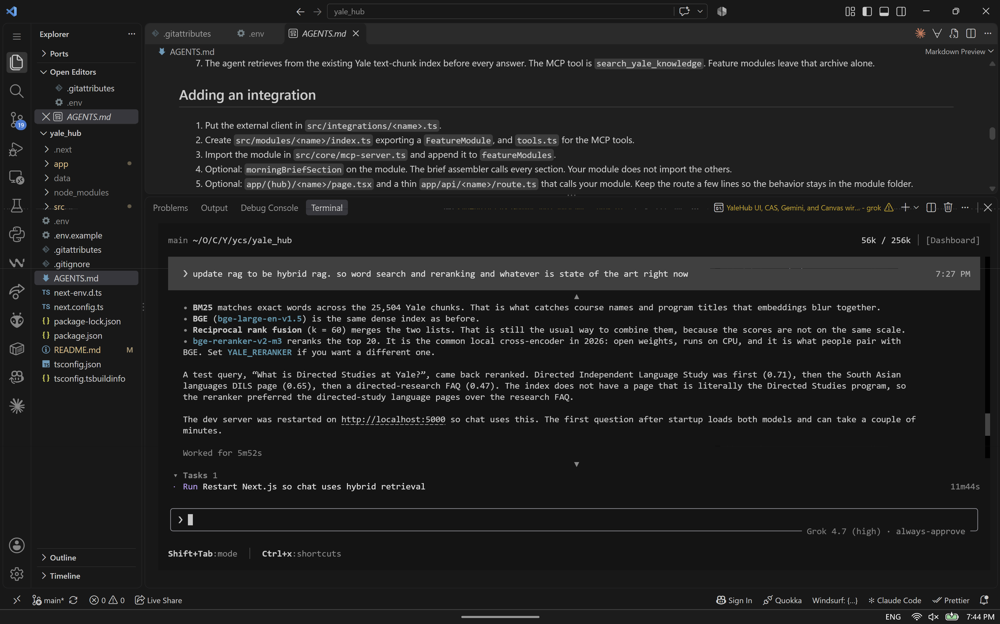

# YaleHub

YaleHub is a personal campus workspace for one Yale student. Sign in with a NetID and the same assistant can answer from a Yale text archive, remember who you are, and act on your calendar, dining hall, course worksheet, Canvas, and morning brief. The dashboard is a Next.js app. Every feature is a module that registers tools on one MCP server, so chat and the pages share one set of capabilities.

Built in a short hackathon by three people working in parallel. Who owns which folder is in [AGENTS.md](AGENTS.md).

## Proof of Grok

Grok was used in the editor while building YaleHub. The session below is Grok 4.7 inside this repo, with `AGENTS.md` open, implementing hybrid retrieval: BM25, the BGE index, reciprocal rank fusion, and `bge-reranker-v2-m3`.



## The idea

A Yale day is split across Canvas, CourseTable, Yale Hospitality, Google Calendar, the Yalies directory, and dozens of Yale web pages. YaleHub keeps the student record in one place and puts a tool-using assistant in front of it. The assistant always sees the signed-in profile and retrieved Yale pages before it answers, then calls the same tools the sidebar pages use.

## What a signed-in student gets

| Surface | What it does |
| --- | --- |
| Assistant (`/chat`) | The home screen. Persistent conversations, a campus-updates panel, and answers that can call every registered tool. Suggested prompts cover the day and dinner. |
| Dashboard (`/?view=dashboard`) | Greeting, quick ask, toolkit cards for each module, profile corner, and the last few episodes. `/` itself opens the assistant. |
| Profile (`/profile`) | Name, email, college, class year, major, and pronouns. Recent episodes sit under the form. Reach it from the account chip. |
| Calendar | Upcoming events, add and delete, Google Calendar connect, and an automatic sync. Until OAuth is set, events stay in `data/calendar/`. |
| Courses | CourseTable search for the current term, a saved worksheet, and a Yalies lookup. |
| Canvas | Active courses and the to-do list from canvas.yale.edu. Read only. |
| Dining | A Yale Hospitality menu from Nutrislice. The hall follows the residential college on the profile. |
| Morning brief | One markdown email assembled from every module, with a button to send a test. |

After sign-in, YaleHub refreshes a campus snapshot: the next seven days of calendar, saved courses, the current meal, Canvas courses, to-dos, assignments, and announcements, the student's Yalies entry, and brief delivery. That snapshot is shown in chat and included in the next answer. A source that fails is marked unavailable. A missing token is reported as a failed connection.

## How a question is answered

Every turn follows the same loop in `src/core/agent.ts`:

1. Load or create the profile for the signed-in NetID.
2. Retrieve Yale chunks, recent episodes, and the campus snapshot **before** the model sees the question.
3. Call Gemini (`gemini-4-hydrogen` on the Interactions API) with that context, the recent conversation, and the full MCP tool list.
4. Run tool calls through an in-process MCP client, up to five rounds.
5. Append a short episode, and save the full turn on the conversation.

Conversations live per NetID. A reply is stored with the tools it used and the Yale excerpts it saw. Repeating a request id returns the saved turn, so a refresh does not run the same action twice.

With `GEMINI_API_KEY` unset, the turn still retrieves and returns the profile plus the chunks. `XAI_API_KEY` is used only when the Gemini key is empty.

## Memory

Memory is the core. Feature modules read the profile. They do not write the memory files themselves.

- **Profile.** One JSON file per NetID under `data/profiles/`. College, class year, major, pronouns, and a preference bag per module. The agent updates stable facts with `update_student_profile`. The profile page writes through the same store.
- **Episodes.** A JSONL log per NetID under `data/episodes/`. Each chat turn appends a short summary. The profile page and the dashboard show recent ones.
- **Conversations.** Full chats under `data/`, with history the model sees on the next message in that thread.
- **Campus snapshot.** A cached read of calendar, courses, dining, Canvas, Yalies, and briefs, refreshed on sign-in and from the chat updates panel. Fresh for 15 minutes unless the student forces a refresh.
- **Yale knowledge.** A fixed archive of about 25,500 Yale text chunks. See retrieval below.

Secrets stay in the environment: the Canvas token, the Google client secret, and API keys. They are not stored on the profile.

## Hybrid retrieval

`search_yale_knowledge` reads the existing chunk archive (default `../AI_girlfriend/backend/embeddings_with_text_v5.npz`) through `src/integrations/vector_bridge.py`. The archive holds float32 `BAAI/bge-large-en-v1.5` vectors and the chunk strings. Queries use the prefix the index was built with (`Query: …`). Scoring is a dot product of L2-normalized vectors.

Each question runs three stages:

1. **BM25** (Okapi, k1 = 1.5, b = 0.75) over the chunk text, so a course code, a program name, or a college is not lost when the embedding blurs it.
2. **Dense search** against the BGE vectors already in the archive. The dense pool and the BM25 pool are each 40 chunks.
3. **Reciprocal rank fusion** (k = 60) merges those lists. **`BAAI/bge-reranker-v2-m3`** then reorders the top 20. That cross-encoder is the usual local reranker paired with BGE. Set `YALE_RERANKER` to swap it.

The first query loads both models on CPU and can take a few minutes. Later queries reuse the process. Python needs `numpy` and `sentence-transformers`.

```powershell
python src/integrations/vector_bridge.py --check
```

## Sign-in

Yale test CAS, matching the Yale Books localhost registration.

- Login: `https://secure-tst.its.yale.edu/cas/login`
- Validate: `https://secure-tst.its.yale.edu/cas/p3/serviceValidate`
- Service URL: `http://localhost:5000/login_callback`

Open **http://localhost:5000**. The host must be `localhost`. Yale's test allowlist is that exact callback, so `127.0.0.1` is rejected. A successful ticket becomes an HMAC-signed `yalehub` cookie (HttpOnly, SameSite=Lax, seven days), so the session survives a server restart. Sign-in lands on the assistant and starts a campus refresh.

`CAS_MODE=mock` swaps in a local NetID form and accepts the `X-NetID` header for curl. Yale mode ignores that header. The student's password is entered on Yale's page. YaleHub only receives the validated NetID.

## Modules and tools

A feature is a folder under `src/modules/` that exports a `FeatureModule`: a list of MCP tools and an optional `morningBriefSection`. Modules do not import each other. They read `ctx.profile` and call their own file under `src/integrations/`. The only wiring into the agent is one import in `src/core/mcp-server.ts`.

| Module | Owner | Tools |
| --- | --- | --- |
| Memory | Memory and agent | `search_yale_knowledge`, `get_student_profile`, `update_student_profile`, `remember_episode`, `recall_episodes` |
| Calendar | Jack | `list_calendar_events`, `create_calendar_event`, `update_calendar_event`, `move_calendar_event`, `delete_calendar_event`, `run_calendar_auto_update` |
| Dining | Aiden | `get_dining_menu` |
| Courses | Aiden | `search_courses`, `save_course`, `remove_course`, `list_saved_courses`, `lookup_yalies` |
| Canvas | Read-only addition | `list_canvas_courses`, `list_canvas_assignments`, `list_canvas_todo`, `list_canvas_announcements` |
| Briefs | Aiden | `get_morning_brief`, `list_brief_sources`, `send_morning_brief` |

`get_morning_brief` asks every module for its section and renders one markdown email. Calendar contributes today's events, dining the hall menu, courses today's saved sections, Canvas the to-do list, and briefs the delivery status. Without `SMTP_HOST`, the send button writes a copy under `data/briefs/`.

Calendar events live in `data/calendar/` until Google OAuth is configured. Connecting Google uploads events that were created locally and pulls the primary calendar. Dining caches under `data/dining/`. Saved courses live under `data/courses/`.

### Add a feature

1. Put the external client in `src/integrations/<name>.ts`.
2. Add `src/modules/<name>/` exporting a `FeatureModule`.
3. Append it to `featureModules` in `src/core/mcp-server.ts`.
4. Add `app/(hub)/<name>/page.tsx` only if it needs a screen. That route group is the sidebar layout.

The dashboard lists whatever is registered.

## Stack

- **App:** Next.js 16 App Router, React 19, TypeScript. Dev server is `next dev` on `localhost:5000`.
- **Agent:** Gemini Interactions API by default. Tools are MCP (`@modelcontextprotocol/server` and client) over an in-process transport. `npm run mcp` also exposes them on stdio.
- **Retrieval:** Python worker, NumPy BM25, `sentence-transformers` for BGE and the cross-encoder.
- **Campus data:** Google Calendar API, Nutrislice (Yale Hospitality), CourseTable, Yalies, Canvas REST, SMTP through nodemailer.

The app boots with empty keys. Each integration starts working when its own variable is set. Dining menus and CourseTable search run without an extra key. Canvas, Yalies, Google Calendar, and real email wait on their credentials.

## Run

Node 20 or newer, and a Python with `numpy` and `sentence-transformers`.

```powershell
npm install
copy .env.example .env
npm run dev
```

Open http://localhost:5000 and choose **Continue with NetID**. For a machine that cannot reach CAS, set `CAS_MODE=mock` and use the NetID form.

A short path for a reviewer:

1. Sign in. The assistant opens and starts a campus refresh.
2. Open **My profile** and set a residential college. Dining uses that hall.
3. Ask “What is for dinner today?” and “What is on my calendar today?”
4. Ask a Yale question, such as “What is Directed Studies?” The reply lists the retrieved pages.
5. Open Calendar, Courses, Dining, Canvas, and Morning brief from the chat sidebar or from `/?view=dashboard`.
6. On Morning brief, send a test. With SMTP unset, the message lands in the local outbox.

Typecheck and the stdio MCP server (set `YALEHUB_NETID` so that process knows who is signed in):

```powershell
npm run typecheck
npm run mcp
```

## Configuration

Copy `.env.example`. Leave unused keys empty.

| Variable | Role |
| --- | --- |
| `GEMINI_API_KEY` | Answers and calls tools. Model defaults to `gemini-4-hydrogen`. |
| `GEMINI_MODEL` | Override the Gemini model id. |
| `XAI_API_KEY` | Used when `GEMINI_API_KEY` is empty. |
| `CAS_MODE` | Empty uses Yale test CAS. `mock` is a local NetID form. |
| `ORIGIN` | `http://localhost:5000` for the test-CAS allowlist. |
| `CAS_LOGIN_URL`, `CAS_VALIDATE_URL` | Test CAS endpoints. Override only if Yale issues new ones. |
| `SESSION_SECRET` | HMAC key for the session cookie. A localhost default is used when unset. |
| `YALE_EMBEDDINGS` | Path to `embeddings_with_text_v5.npz`. |
| `YALE_RERANKER` | Cross-encoder. Default `BAAI/bge-reranker-v2-m3`. |
| `PYTHON` | Interpreter for the retrieval process. |
| `GOOGLE_CLIENT_ID`, `GOOGLE_CLIENT_SECRET`, `GOOGLE_REDIRECT_URI` | Google Calendar. The redirect must match the Cloud client. Default `http://localhost:5000/api/calendar/google/callback`. |
| `YALIES_API_KEY` | Yalies directory lookup. Course search does not need it. |
| `CANVAS_API_TOKEN` | Canvas access token (Account, Settings, New Access Token). Read-only is enough. |
| `CANVAS_BASE_URL` | Default `https://canvas.yale.edu`. |
| `SMTP_HOST`, `SMTP_PORT`, `SMTP_USER`, `SMTP_PASS`, `SMTP_FROM` | Real morning email. Unset keeps the message in the local outbox. |
| `YALEHUB_NETID` | NetID for `npm run mcp`. The web app uses the login cookie. |

`data/` is gitignored. Profiles, episodes, conversations, calendar events, course worksheets, dining caches, and brief outboxes stay on the machine.

## Layout

```
src/core/            profile, episodes, chats, campus snapshot, hybrid retrieval, agent loop, MCP server, CAS
src/modules/         calendar, dining, courses, canvas, briefs
src/integrations/    gcal, nutrislice, yalies, canvas, catalog helpers, vector bridge
app/(hub)/           assistant, dashboard, and feature pages
app/login            NetID button, or the mock form
app/login_callback   Yale CAS return
app/api/             profile, chat, campus refresh, and one route per feature
```
